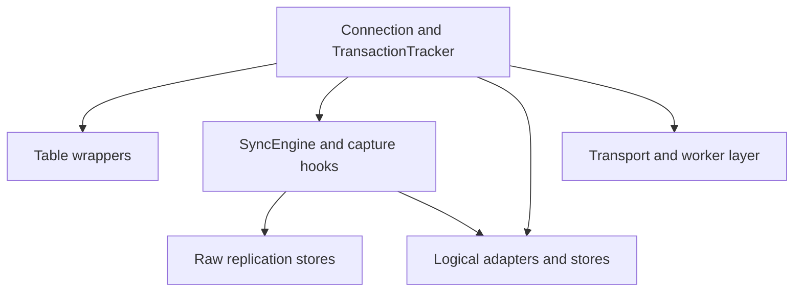
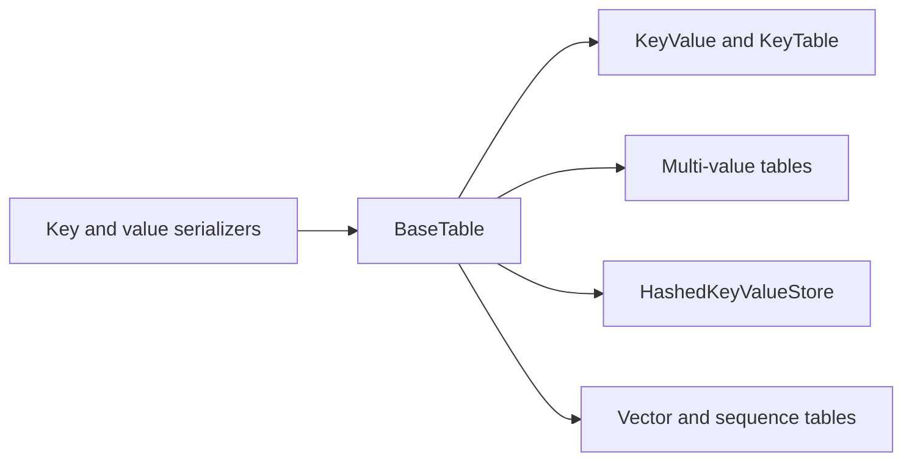
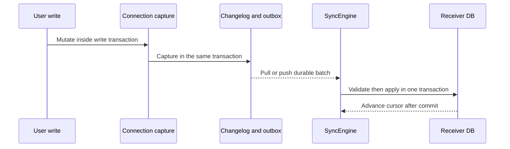

# Architecture map

## Runtime structure

`Connection` owns the MDBX environment and the per-thread transaction tracker. `Transaction` owns one native transaction handle and unregisters it on commit, rollback, or destruction. Table wrappers keep a shared `Connection` and one DBI handle. Sync capture hooks run in the same write transaction as the user mutation. The pre-commit hook publishes durable capture records before native commit, and discard hooks clear pending capture state when the transaction ends.

## Table and utility layer

`BaseTable` validates the connection and table name, opens the user DBI, reads flags, and provides transaction helpers. Key encoding is owned by the serializer utilities. Reconciliation uses the same canonical key encoding used for MDBX writes.

## Raw sync flow

Raw replication stores include metadata, changelog, applied cursor, origin index, identity index, selective scope state, receiver mode state, snapshot staging, and versioned DBI markers. They are opened with explicit transaction ownership. Optional-store reads use the MainDB catalog lookup added by the corrective branch.

## Logical sync flow

Logical adapters translate typed table mutations into logical changes. Schema markers, DBI bindings, journal rows, delivery markers, outbox entries, and ordered frontiers are durable MDBX state. Logical apply validates schema and adapter preconditions before applying changes. Ordered delivery advances its frontier only with the corresponding user mutation transaction.

## Supported consistency models

| Path | Model represented by the code |
| --- | --- |
| Raw global replication | Authoritative-origin delivery with durable per-origin sequence and receiver cursor |
| Selective replication | One designated writer per immutable scope and receiver mode fencing |
| Source-version DBI | Source-version-wins per identity key with durable tombstones |
| Logical ordered delivery | One authoritative ordered origin with contiguous receiver frontier |
| Snapshot import | Bounded staged publication with resume and final cursor commit |
| Transport workers | Bounded scheduling and cooperative shutdown around the same engine transaction boundaries |

These paths do not constitute unrestricted multi-master conflict resolution. Conflict handling is explicit per path and is fail-closed when the stored schema or ownership marker is incompatible.

## Packaging

CMake builds a header-only `mdbx_containers` interface target and links the selected libmdbx provider. The installed package exports `mdbx_containers::mdbx_containers` and resolves the external `mdbx` package through the generated config. Repository-local `AGENTS.md` files are excluded from the installed include tree by the corrective branch.

